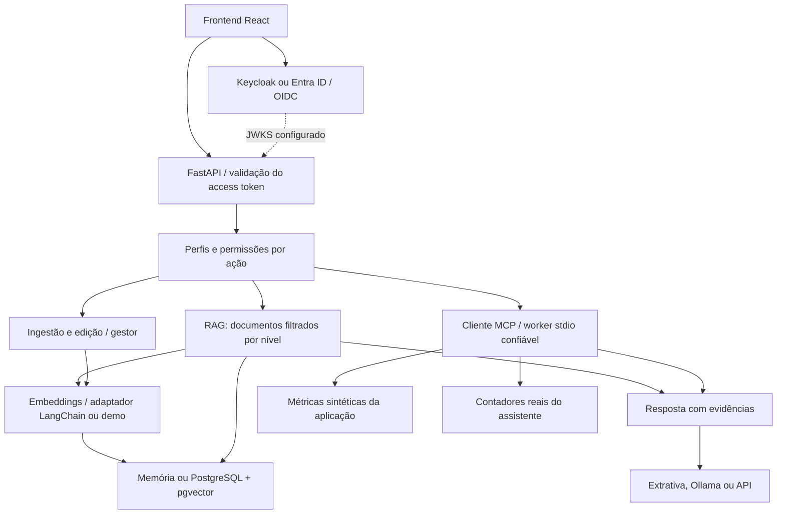

# Arquitetura de componentes — v0.2

A UI inclui mapa interativo dos fluxos login, consulta RAG, ingestão e ferramentas. Ele explica topologia; não anima tráfego real.

## Separação de responsabilidades

- Identidade: token OIDC validado ou credencial demo, nunca ambos no modo OIDC.
- Política: perfis conhecidos concedem permissões; documentos têm nível 1/2. Nível 2 e gestor leem ambos; apenas gestor escreve; apenas nível 2 lê métricas.
- RAG: chunking 900 caracteres com passo 750, embeddings e busca cosseno. Filtra nível antes do ranking/contexto. A demo usa hashing lexical.
- Persistência: documento original e chunks atualizados juntos em transação PostgreSQL; armazenamento em memória com lock no laboratório. Busca exata, sem índice aproximado.
- Provedor: LangChain encapsulado no adaptador. A autorização não depende da biblioteca nem do modelo.
- Ferramentas: solicitação explícita, allowlist e validação de permissão na API e no worker. O modelo não executa comandos.
- Observabilidade: contadores por processo e snapshot enviado ao worker MCP. Não é consulta a um banco de telemetria ou avaliação automática de qualidade.

## Fronteiras de confiança

Navegador é não confiável. Documentos e respostas também. IdP tem emissor/audiência/chaves configurados. Worker MCP stdio é um subprocesso da mesma aplicação; não é MCP remoto. Provedores de IA recebem dados apenas conforme configuração e política aprovada. Banco usa parâmetros SQL e namespace acl-v2.

A listagem e a leitura direta de documentos aplicam o mesmo filtro do RAG; documento não autorizado retorna 404. O gestor altera classificação e reindexa. Ingestão não aceita grupos arbitrários ou permissões do cliente.

## Persistência e upgrade

Namespace inclui provedor, modelo e acl-v2. Alterar pesos/dimensão sob o mesmo nome requer namespace novo e reindexação. Dados v0.1 ficam separados. Seed apenas cria documentos ausentes. Memória não compartilha estado entre workers e é perdida no restart; PostgreSQL é necessário para persistência e para compartilhar ingestões entre web e busca MCP em outros processos.

## Endpoints

GET /api/auth/config é público e expõe somente configuração de login. /api/config retorna identidade/permissões sem segredos. GET /api/documents lista metadados permitidos; GET /api/documents/{id} retorna texto autorizado. POST /api/documents inclui ou substitui, apenas gestor. POST /api/chat consulta RAG e opcionalmente MCP. GET /api/observability consulta ferramenta de métricas do assistente, apenas nível 2.

## Governança e admissão — v0.4

GET /api/governance expõe políticas e evidências apenas após autenticação e permissão documental. GET /api/runtime exige ai-metrics:read e consulta endpoints de leitura fixos no Ollama configurado. POST /api/chat aplica admissão por subject e concorrência antes da recuperação; o adaptador valida o limite de caracteres antes de gerar. O resultado pode incluir uso informado pelo provedor, sem estado de uso global por adaptador. [Controles, métricas e lacunas](12-governance-and-operations.md).
