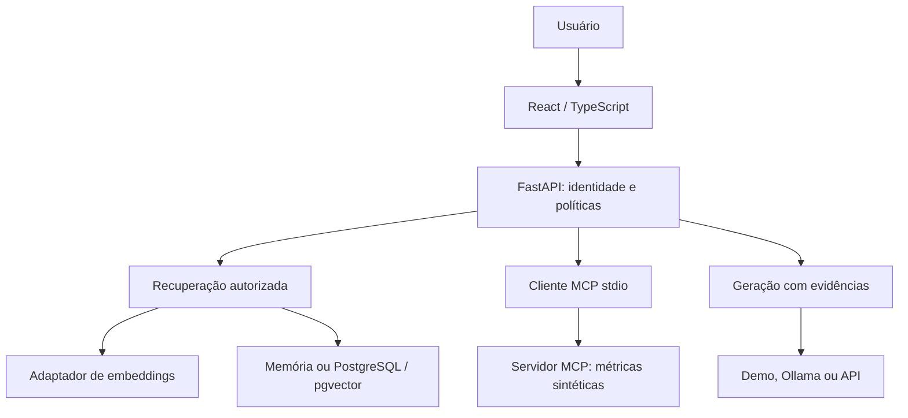

# Arquitetura

Monólito modular com frontend separado. O processo MCP é uma fronteira de protocolo, não um microserviço distribuído obrigatório. Docker Compose é o ambiente de laboratório.

## Fluxo de consulta

1. Validar Bearer e resolver grupos pela configuração do servidor.
2. Se houver pedido de métricas, exigir operations antes de chamar dependências.
3. Gerar embedding da pergunta e filtrar documentos por interseção de grupos antes do ranking.
4. Selecionar até TOP_K trechos e, se solicitado, chamar MCP com serviço em allowlist.
5. Construir contexto com evidências. O modelo não pode escolher comandos, servidores ou ferramentas.
6. Retornar resposta, trechos recuperados, métricas, trace e duração. A interface renderiza texto sem HTML/Markdown executável.

## Fronteiras

| Fronteira | Confiança e controle |
|---|---|
| Navegador → API | Pergunta e texto são não confiáveis; validação e autorização no servidor |
| API → documentos | Metadados atribuídos por operações; acesso OR entre grupos |
| API → provedor | Conteúdo pode deixar o ambiente no modo API; aprovação de dados é pré-requisito |
| API → MCP | Executável fixo, ambiente explícito, credencial fora dos argumentos da ferramenta |
| MCP → métricas | Fixture sintética; nenhuma chamada a ambiente real |
| Aplicação → banco | Consultas parametrizadas, namespace por embedding; credencial LAB |

## Persistência e recuperação

A busca em memória usa similaridade de cosseno. Demo tem hashing lexical de 256 dimensões; Ollama/API usam embeddings do provedor. PostgreSQL armazena vetores e metadados e usa `groups && grupos_do_usuario` junto ao namespace antes do ranking. Não há índice aproximado na v0.1: priorizamos exatidão e auditoria em corpus pequeno. Aumentar escala exige benchmark, índice por dimensão/modelo, RLS e controle de concorrência.

A ingestão substitui todos os chunks de um documento, em transação no PostgreSQL. A implantação de referência é de um worker; memória não compartilha estado entre workers. Servidor MCP stdio é criado por consulta de métricas; uma sessão persistente exige supervisão de ciclo de vida e isolamento de identidades.

## Onde LangChain entra

Somente no adaptador de chat/embeddings. Autorização, corpus, ferramentas e regras permanecem em módulos próprios. Não há agente autônomo ou LangGraph nesta etapa.

## MCP externo

A partir da raiz, com o pacote instalado, execute `python -m workbench.mcp_server` e forneça `MCP_AUTH_TOKEN` por ambiente. Um cliente MCP stdio precisa iniciar esse comando no diretório do repositório, com o mesmo ambiente `.env` apropriado.

Ferramentas: `search_documents(query)` e `get_service_metrics(service)`. O servidor usa a identidade do host local; não é um endpoint MCP remoto multiusuário. Não compartilhe um processo entre identidades. Em memória, a busca MCP reabre o corpus empacotado; PostgreSQL permite compartilhar ingestões web. Não registre tokens em configurações versionadas do cliente.
