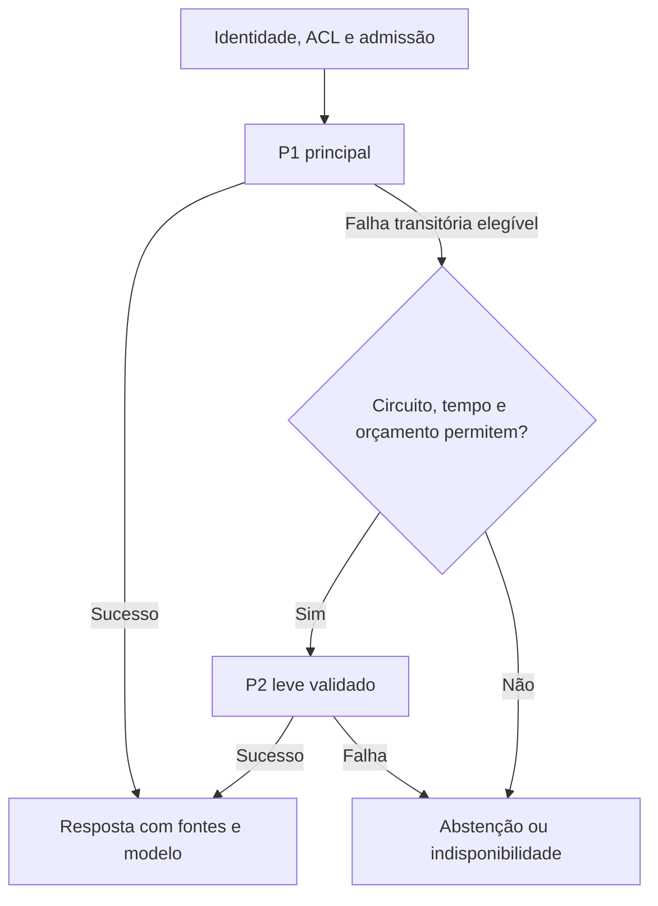

# Guias de governança por pilar

## Escopo

A interface oferece submenus de referência dentro de cada pilar, separados dos controles efetivamente implementados. O catálogo fica em frontend/src/governanceReference.ts; a composição visual em PillarReference.tsx. Nenhum limiar do catálogo é lido pelo backend para executar ações.

Os limiares numéricos são **exemplos de desenho** para discussão e calibração, não metas aprovadas nem sinais reais do ambiente. As taxas atuais são por processo e a latência usa até 500 amostras: não suportam, por si, um alerta temporal distribuído de cinco minutos.

Os estados de medição no guia distinguem sinal medido, cobertura parcial e instrumentação planejada. O estado do pilar continua vindo de /api/governance. A referência não modifica permissões, modelos, orçamento ou infraestrutura.

## Modelos principal e leve

A seção de Confiabilidade apresenta a configuração atual como P1, ou um exemplo marcado quando a aplicação usa demo sem LLM. Para Ollama, qwen2.5:1.5b é um candidato de rota leve em relação ao exemplo qwen2.5:3b. Se o modelo ativo já for 1.5b, o guia pede selecionar outro candidato validado em vez de propor fallback para ele mesmo.

Essa escolha é uma hipótese de arquitetura, não resultado de benchmark: validar qualidade, contexto, licença, disponibilidade, memória e latência de ambos. O candidato não é baixado nem presumido instalado. Em API corporativa, o guia pede um modelo leve aprovado no mesmo perímetro contratual.

**Fallback automático e circuit breaker não estão implementados.** O laboratório continua chamando apenas o modelo configurado.

Fluxo de referência:

Uma rota degradada deve informar motivo, modelo efetivamente usado e tentativas. Preservar ACL, escopo, contexto autorizado e controles numéricos. 401/403 ou rejeição de segurança não autorizam tentar outro modelo ou endpoint.

Não planejar P1 e P2 como redundância de infraestrutura quando ambos usam o mesmo daemon, GPU ou host. Sob OOM, carregar mais pesos pode piorar o incidente; cold start e carregamento entram no deadline. Independência de falha exige desenho e validação próprios.

## Gatilhos de referência

| Pilar | Exemplo de gatilho proposto | Ação a projetar | Condição de retorno |
|---|---|---|---|
| Operação | Falhas > 5% em 5 min e pelo menos 20 execuções | Incidente, diagnóstico por etapa e responsável | Janela estável e revisão da causa |
| Segurança | Qualquer acesso fora do perfil | Conter o caminho afetado e preservar auditoria | Correção e testes negativos antes de liberar |
| Confiabilidade | Cinco falhas transitórias consecutivas | Circuito aberto por 30 s e avaliação de alternativa | Sonda half-open bem-sucedida; sem oscilação |
| Performance | Espera p95 na fila > 2 s por 3 min | Avaliar capacidade de inferência, não apenas mais API | Demanda baixa sustentada, cooldown e drenagem |
| Custos | 80% do orçamento projetado; reserva acima de 100% | Alerta; negar nova admissão acima do teto proposto | Nova janela ou aprovação, com reconciliação |
| Sustentabilidade | Inferência ociosa por 15 min | Avaliar unload/scale-in sem violar SLO de cold start | Aquecimento controlado para retomada |

Esses gatilhos exigem série temporal, avaliação, acionamento e estado compartilhado que ainda não existem. Um alerta financeiro baseado em faturamento atrasado não é um bloqueio antes da chamada. As ações de contenção ou aumento de custo precisam de política e responsáveis definidos.

## Resiliência

- Usar timeout por etapa e deadline total. Retry do SDK, retry do gateway e fallback devem compartilhar limites de tentativas, tempo e custo.
- Repetir apenas falhas transitórias elegíveis, respeitando Retry-After, backoff e jitter. Não repetir falhas de autorização/configuração cegamente.
- Circuit breaker separa closed, open e half-open. Limitar sondas e evitar retorno ao principal a cada requisição.
- Bulkhead, fila limitada, backpressure e rejeição explícita evitam propagação de saturação.
- Testar falha do principal, falha dupla, OOM, timeout, recuperação do circuito e retorno sem tempestade de retries.
- Definir RTO/RPO, backup/restore e ensaios. Memória local não equivale a recuperação de desastre.

## Escalabilidade e elasticidade

Escalabilidade trata de suportar crescimento. Elasticidade trata de ajustar capacidade à demanda. O desenho de referência separa:

| Camada | Métricas necessárias | Cuidados |
|---|---|---|
| API | Concorrência, espera, CPU e latência da API | Estado externo, quotas compartilhadas e telemetria agregada |
| Inferência | Throughput, fila, TTFT, VRAM/CPU e cold start | Pools por modelo; benchmark de batching, KV cache e concorrência |
| Dados | Latência de busca, conexões e volume de corpus | Persistência, índices, isolamento e capacidade de ingestão |
| Controle de uso | Tokens/min, saldo de orçamento e limites do provedor | Admissão global; escalar workers não pode multiplicar quota inadvertidamente |

Configurar mínimo/máximo, readiness com modelo carregado, cooldown e drenagem antes de remover capacidade. Quatro processos com quota local de 30/min podem admitir 120/min no agregado. Mais workers na mesma GPU não garantem mais throughput.

**Não há autoscaling no Compose atual.** Não foram criadas réplicas, regras HPA ou serviços de escalonamento nesta etapa.

## Elasticidade de custos

O guia de Custos propõe orçamento por produto/ambiente com moeda, período e responsável; previsão de uso; reserva no ledger compartilhado; execução e reconciliação com o provedor. Considerar embeddings, tentativas, fallback e chamadas falhas, além da geração concluída.

Antes da chamada, tokenizador e teto de saída podem apoiar estimativa/reserva. Caracteres não são garantia universal de tokens. O limite de gasto deve ser aplicado na admissão, com tratamento de concorrência, falha do ledger, idempotência e reservas expiradas.

Modelo leve só é uma alternativa econômica se mantiver qualidade e reduzir custo por tarefa útil. Retrabalho e retries podem anular economia por chamada. Custo local inclui hardware, idle e energia; não deve aparecer como zero.

**Ainda não há ledger financeiro, orçamento bloqueante, quota distribuída ou conciliação de cobrança no laboratório.** Preços configurados continuam sendo estimativa parcial de geração.

## Segurança e sustentabilidade

O guia de Segurança inclui OIDC/PKCE, validação JWT, isolamento por perfil, allowlist de ferramentas, prompt injection e egress. Uma rota alternativa não pode ampliar permissão ou enviar fonte restrita a provedor sem aprovação. Cache deve considerar identidade/escopo e versões de modelo/documento; reclassificação exige invalidação.

O guia de Sustentabilidade relaciona dimensionamento, ociosidade, contexto, quantização e avaliação por tarefa útil. Reduzir tokens não prova redução de energia ou CO₂. Medição energética exige instrumento, fronteira de medição, período e método documentados; incluir idle e cold start.

## Referências primárias

- [Circuit Breaker — Azure Architecture Center](https://learn.microsoft.com/en-us/azure/architecture/patterns/circuit-breaker)
- [Retry — Azure Architecture Center](https://learn.microsoft.com/en-us/azure/architecture/patterns/retry)
- [Target tracking, métricas e cooldown — AWS](https://docs.aws.amazon.com/autoscaling/application/userguide/target-tracking-scaling-policy-overview.html)
- [OIDC Core](https://openid.net/specs/openid-connect-core-1_0.html)
- [Qwen2.5 1.5B no Ollama](https://ollama.com/library/qwen2.5:1.5b)
- [Memória reportada pelo Ollama](https://docs.ollama.com/api/ps)
- [Controles efetivos da v0.4](12-governance-and-operations.md)
